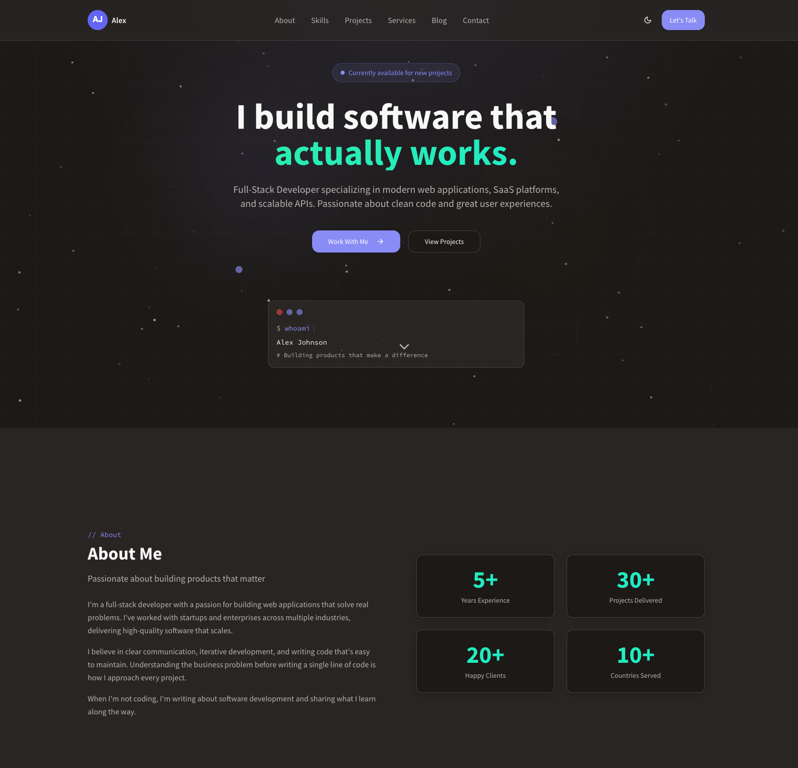
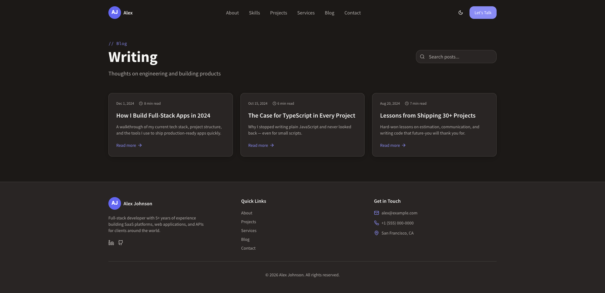
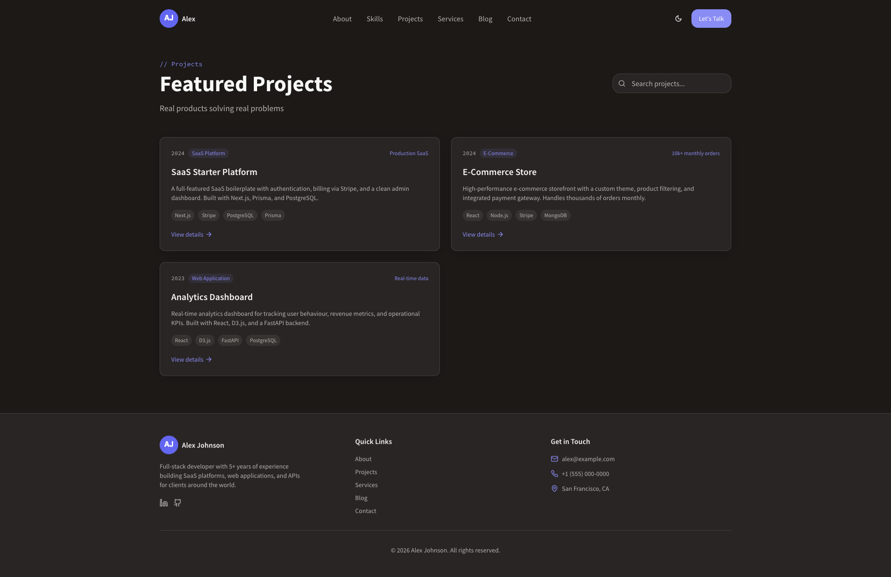
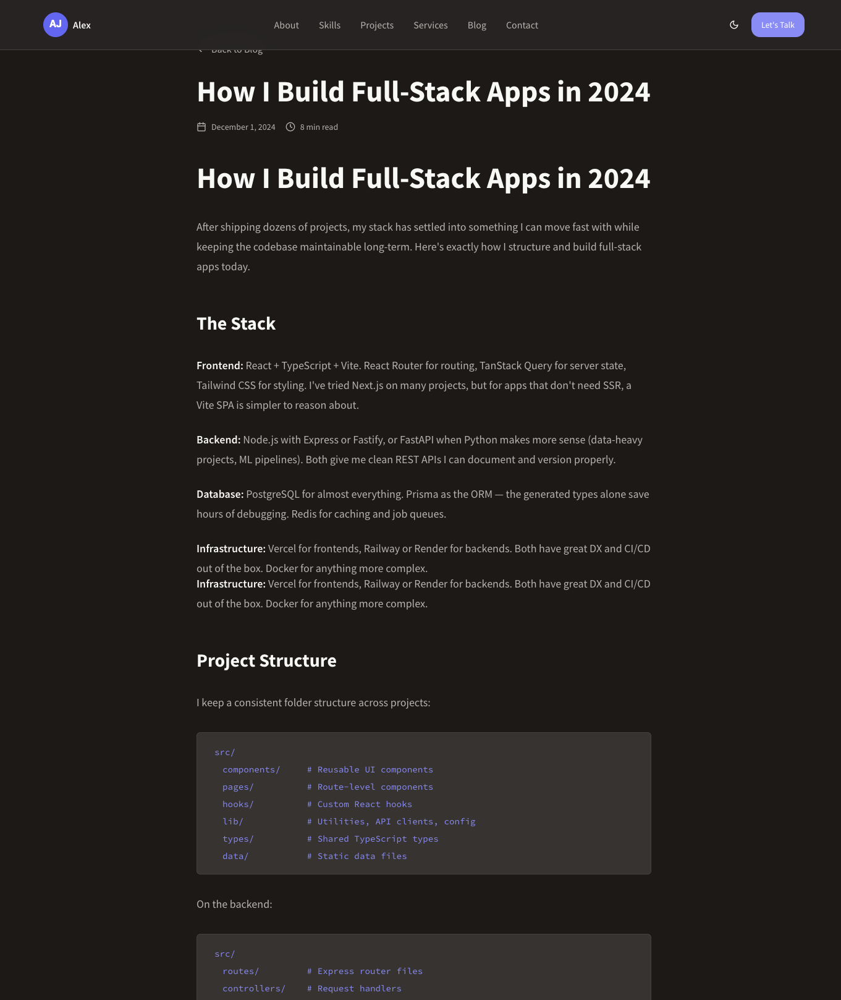
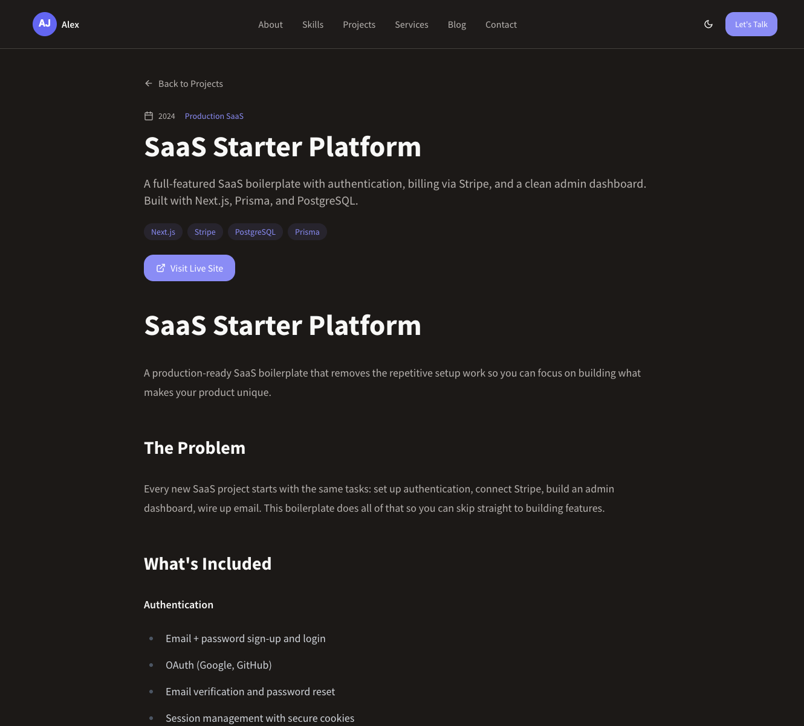
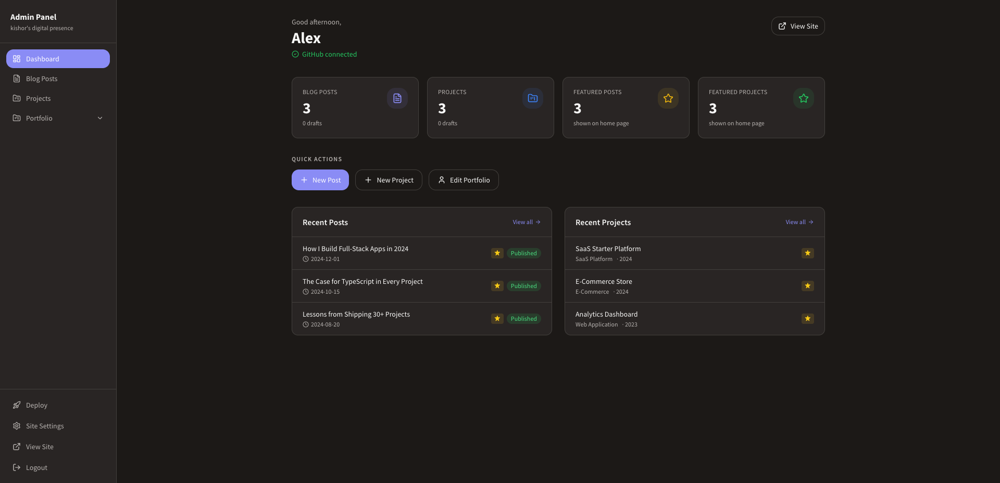
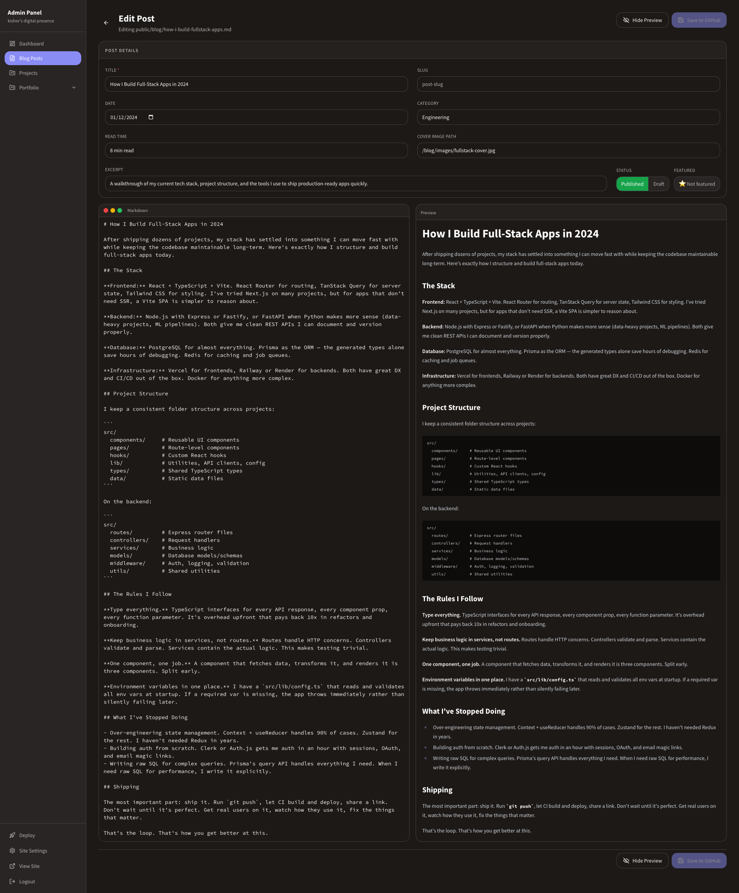
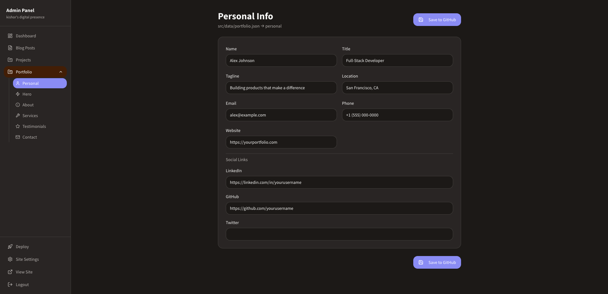
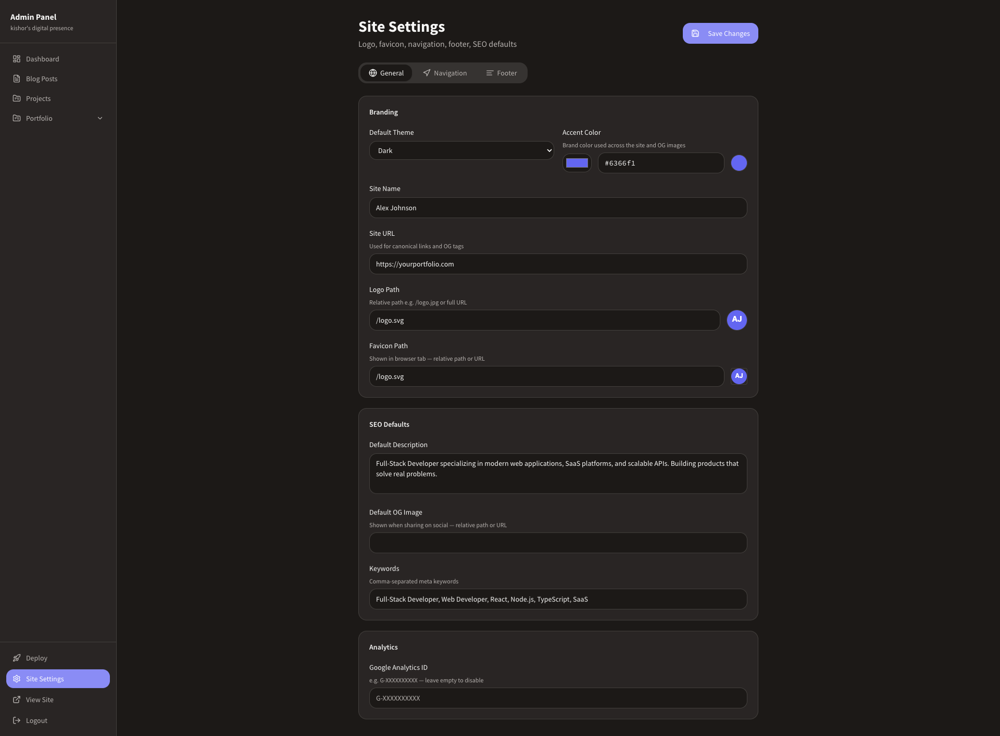

# gitfolio

Open-source portfolio CMS with a built-in admin panel. Markdown blog, project showcase, and full portfolio management — all from a browser UI. Changes auto-commit to GitHub and trigger a Vercel rebuild. No database, no server, no subscription.

**[Live demo →](https://www.kishorkumarmahato.com.np/)**

**[Live demo →](https://gitfolio-tau.vercel.app/)**


> ⭐ **If you find this useful, star and fork the repo** — it helps others discover it.
>
> [★ Star](https://github.com/cyberkishor/gitfolio) · [🍴 Fork](https://github.com/cyberkishor/gitfolio/fork) · [🐛 Issues](https://github.com/cyberkishor/gitfolio/issues)

[](https://vercel.com/new/clone?repository-url=https%3A%2F%2Fgithub.com%2Fcyberkishor%2Fgitfolio&env=VITE_ADMIN_PASSWORD,VITE_GITHUB_TOKEN,VITE_GITHUB_OWNER,VITE_GITHUB_REPO,VITE_GITHUB_BRANCH&envDescription=Admin%20panel%20credentials%20and%20GitHub%20API%20access&envLink=https%3A%2F%2Fgithub.com%2Fcyberkishor%2Fgitfolio%23environment-variables&project-name=my-gitfolio&repository-name=my-gitfolio)

---

## Screenshots

### Frontend

| Home | Blog | Projects |
|------|------|----------|
|  |  |  |

| Blog Post | Project Detail |
|-----------|----------------|
|  |  |

### Admin panel

| Dashboard | Blog Editor | Portfolio Editor |
|-----------|-------------|-----------------|
|  |  |  |

| Site Settings |
|---------------|
|  |

---

## What's included

- **Portfolio site** — hero, about, skills, projects, services, testimonials, blog, contact
- **Blog** — markdown-powered, with cover images, categories, and read time
- **Project case studies** — full markdown pages for each project
- **Admin panel** at `/admin` — password-protected, manage everything from the browser
- **Dynamic OG images** — auto-generated for every page and blog post
- **Site settings** — logo, favicon, accent color, theme, nav, footer — all editable in admin
- **Deploy button** in admin sidebar — trigger a Vercel rebuild on demand

---

## Quick start

### Option A — npm create (fastest)

```bash
npm create gitfolio@latest my-portfolio
```

The CLI clones the template, installs dependencies, runs the setup wizard, and makes your first commit.

### Option B — One-click deploy (no CLI needed)

1. Click the **Deploy with Vercel** button above
2. Vercel forks the repo to your GitHub and prompts for env vars
3. Fill in the five env vars (see [Environment Variables](#environment-variables))
4. Clone your new repo locally and run the setup wizard:

```bash
git clone https://github.com/YOUR_USERNAME/my-gitfolio
cd my-gitfolio
npm install
npm run setup
git add -A && git commit -m "setup: personalize portfolio"
git push
```

### Option C — Clone manually

```bash
git clone https://github.com/cyberkishor/gitfolio my-portfolio
cd my-portfolio
npm install
npm run setup
npm run dev    # http://localhost:8080
```

Then create a new GitHub repo and push your portfolio to it:

```bash
git remote set-url origin https://github.com/YOUR_USERNAME/my-portfolio.git
git push -u origin main
```

---

## The setup wizard

`npm run setup` asks a few questions and writes everything for you:

- **Personal info** — name, title, tagline, location, email
- **Social links** — GitHub, LinkedIn, Twitter
- **Site settings** — site name, URL, accent color, theme
- **Analytics** — optional Google Analytics ID
- **Admin credentials** — admin password, GitHub token, repo details

It updates `src/data/portfolio.json`, `src/data/site-settings.json`, and creates `.env.local`.

After setup, replace `public/logo.svg` with your own photo and edit the sample content in `public/blog/` and `public/projects/`.

---

## Environment variables

| Variable | Required | Description |
|----------|----------|-------------|
| `VITE_ADMIN_PASSWORD` | Yes | Password for `/admin/login` |
| `VITE_GITHUB_TOKEN` | Yes | GitHub personal access token (`repo` scope) |
| `VITE_GITHUB_OWNER` | Yes | Your GitHub username or org |
| `VITE_GITHUB_REPO` | Yes | Repository name |
| `VITE_GITHUB_BRANCH` | Yes | Branch to commit to — usually `main` |
| `VITE_DEPLOY_HOOK_URL` | Optional | Vercel deploy hook URL (enables the Deploy button in admin) |

**Local:** set in `.env.local` (gitignored — never committed).
**Production:** add the same vars in Vercel → Settings → Environment Variables.

### How to get a GitHub token

1. Go to [github.com/settings/tokens](https://github.com/settings/tokens)
2. **Generate new token (classic)**
3. Select scope: `repo`
4. Copy the token (starts with `ghp_`) and paste it as `VITE_GITHUB_TOKEN`

> Tokens expire. If admin saves fail with "Bad credentials", generate a new token and update it in both `.env.local` and the Vercel dashboard.

---

## Vercel deploy hook (optional)

The **Deploy** button in the admin sidebar lets you trigger a rebuild without pushing a commit — useful when you want to batch several edits before going live.

1. Vercel project → **Settings** → **Git** → **Deploy Hooks**
2. Create a hook named `Admin Panel` on branch `main`
3. Copy the URL and set it as `VITE_DEPLOY_HOOK_URL` in `.env.local` and Vercel env vars

To deploy only via the admin button (skip auto-deploy on every push): **Settings → General → Ignored Build Step** → set to `exit 1`. Deploy hooks bypass this check and still work.

---

## Customising your portfolio

### Content files

| What | File |
|------|------|
| Personal info, hero, about, skills, services, testimonials, contact | `src/data/portfolio.json` |
| Site name, logo, favicon, accent color, nav, footer | `src/data/site-settings.json` |
| Blog posts | `public/blog/{slug}.md` |
| Project case studies | `public/projects/{slug}.md` |
| Blog index (all posts) | `public/blog-index.json` |
| Projects index (all projects) | `public/projects-index.json` |

All of these can be edited via the admin panel — you rarely need to touch them directly.

### Accent color & theme

Set `accentColor` in `src/data/site-settings.json` (or via **Admin → Site Settings**). The color propagates as a CSS custom property across the entire site. Dark, light, and system themes are also configurable.

### Logo

Replace `public/logo.svg` with your own photo (square, at least 200×200px). It's used in the header, footer, and OG images. JPG and PNG are also supported — update the path in `src/data/site-settings.json`.

---

## Admin panel

Visit `/admin` — redirects to `/admin/login` if not authenticated. Auth state is stored in `sessionStorage` (clears on tab close).

| Route | Description |
|-------|-------------|
| `/admin/dashboard` | Overview and quick links |
| `/admin/blog` | List, create, edit, delete blog posts |
| `/admin/blog/new` | New blog post with markdown editor + live preview |
| `/admin/blog/:slug` | Edit existing post |
| `/admin/projects` | List, create, edit, delete projects |
| `/admin/projects/new` | New project with markdown editor + live preview |
| `/admin/projects/:slug` | Edit existing project |
| `/admin/portfolio` | Edit all portfolio sections (personal, hero, about, skills, etc.) |
| `/admin/settings` | Site name, logo, favicon, accent color, nav links, footer |

Every save commits directly to GitHub via the API. The Deploy button triggers a Vercel rebuild.

---

## Tech stack

- **Framework:** Vite + React + TypeScript
- **Styling:** Tailwind CSS + shadcn/ui
- **Routing:** React Router v6
- **Markdown:** react-markdown + remark-gfm
- **Toasts:** sonner
- **Icons:** lucide-react
- **Hosting:** Vercel
- **Content:** GitHub API (direct commits from the browser)

---

## License

MIT
